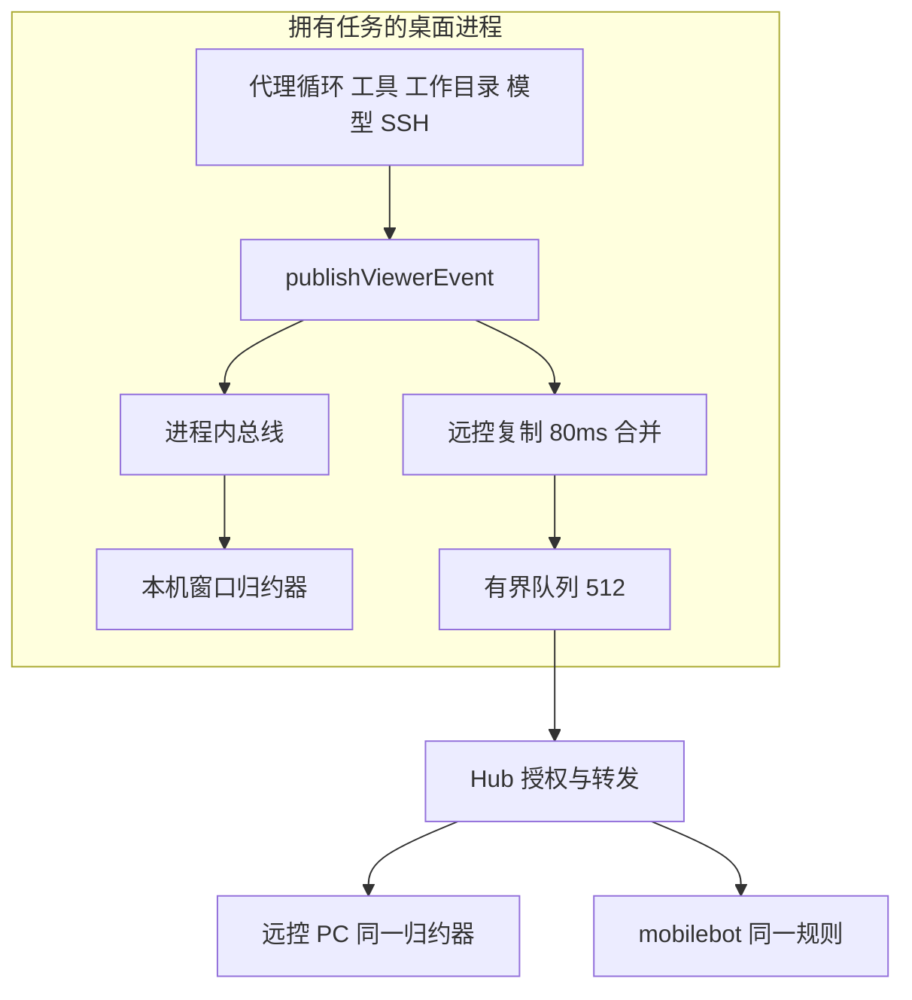
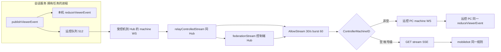

# 会话服务与三端渲染客户：助手查看契约

| 项 | 值 |
| --- | --- |
| 作者 | design-doc-writer |
| 日期 | 2026-11-17 |
| 状态 | Accepted |
| 范围 | 查看契约与三个渲染客户。不改 agent 行为、不改 SSH 重连、不拆进程 |
| 建议入库路径 | `docs/design/remote-control-stream-parity-zh.md`（确认后再搬；本文件是草稿） |

## Overview

跑任务的那台电脑是会话服务：代理循环、工具、工作目录、模型和 SSH 都留在这个 `guiapp` 进程里。不把循环搬到 Hub，也不搬到手机。三个观看者都是渲染客户，吃同一份查看契约：本机窗口、另一台 PC（远控 grant）、`mobilebot`。体验一致是因为归约规则只有一份，不是因为远控去模仿一套更富的本机私有事件。

今天不是这样。本机面板归约 `ai-assistant-*`（`useAIAssistant.ts` 的 `StreamTokenBuffer` / `codingTimeline`）。远控 PC 归约另一套更瘦的 `remote_control.stream`（`applyRemoteStreamPayload`），编码过程进不了对话列。手机不订阅流，只每 3 秒拉被截短的 `get_task`。两套归约器是体验漂移的原因。

本设计把查看契约定成一份。会话服务在进程内先发布它，本机订阅不经过 Hub、不经过 `AllowStream`、也不等线上的合并计时器。Hub 只给远控 PC 和手机做授权与转发。协商到 proto 2 时，线上字节就是本机归约器看到的同一 schema，编码为现有 `remote_control.stream` 的 proto 2（`cursor`、`cursor_from`、`lane`、结构化 `coding`、`snapshot`/`resync`），不是第二种方言。proto 1 线上只是省略新字段的子集。线上才把正文和推理收到 80ms，以留在每秒 30 次的令牌桶里。本地 `emitAIAssistantStreamEvent` 仍不等待 Hub。授权仍是 grant 的 `view` / `operate`。未知 op 仍在 Hub 被拒绝。

「本地也只是渲染客户」指的是同一份事件契约，不是把 `maclaw-gui` 拆成独立代理进程加薄壳。那条路和这份契约的终点相同，但是本次否决的迁移，见 Alternatives，不进入 PR Plan。

仓库里没有名为 `mobilego` 的目录或符号。下文的「手机端」就是 `mobilebot/`（MaClawBot / MaclawGo）。`mobile/maclaw_mobile/` 已废弃，且不调用 `/api/remote-control/`。

## Background & Motivation

### 命名

2026-11-17 在 `D:\workprj\aicoder` 检索 `mobilego`、`gomobile`、Go 手机客户端：

- 没有 `mobilego` 包。
- `gomobile` 只出现在废弃客户端的发布说明里，用来声明**不**嵌入 gomobile。
- 现存远控消费者是 `mobilebot/lib/features/remote/`，HTTP `POST /api/remote-control/grants/{id}/op`。
- 桌面互控是 `guiapp/remote_control.go` 的 `App.RemoteControlOp` → Hub `remote_control.exec` → `App.executeRemoteControl`，直播在 `guiapp/remote_control_stream.go`。

Hub 把没有 `X-Machine-Id` 的调用方记成帐号级控制者：`controllerIdentity` 在 `controllerMachineID == ""` 时返回名为 `移动设备` 的 `Machine`，`ControllerMachineID` 留空（`hub/internal/remotecontrol/service.go`）。手机 grant 因此无法走「推到控制端机器 WebSocket」那条路。

### 本机今天的私有流（迁移期降为适配器）

下面这些是**现状**，不是对齐之后的事实来源。要对齐的是面板状态：回合、正文气泡、推理增量、编码时间线（思考和工具交错）、进度、计划清单、心跳、终稿，以及终稿上的卡片（确认、追问、未完成槽、可恢复会话、编码运行时恢复）。`MACLAW_VIEWER_REDUCER` 关掉时，本机任务面板仍直接听原来的 Wails 事件。那些事件是原始 payload，不是从查看契约反推出来的。开关打开之后，任务面板只归约 `viewer-event`。文件伴读和桌面 Bot 继续听原来的事件。

本机面板只认挂在 `request_id` 上的 `ActiveRound`。后端发起的回合必须先发 `ai-assistant-foreground-round-started`，否则 token 被丢掉。`session_key` 是 `projectSessionOwnerID` 生成的 `desktop-user:<projectPath>`（空路径则是 `desktop-user`）。`projectSessionOwnerID` 先走 `normalizeProjectSessionPath`（盘符大写、分隔符交给 `filepath.Clean`）。

今天有三条互不相通的发布，外加一条旁路。`emitAIAssistantStreamEvent` 先 `relayRemoteStreamEvent` 再 `emitEvent`。`emitAIAssistantResponse` 不走这个函数：它先 `stampProducedFilesIntoConversationMemory`，再 `relayRemoteAssistantResponse`，再 `notifyTaskResponseTray`，最后才 `emitEvent("ai-assistant-response")`。工作台清单是 `emitEvent("coding-workbench-steps")` 之后再 `relayRemoteWorkbenchSteps`（`guiapp/coding_workbench_align.go`）。`SendBtwQuery` 用同一个 `emitAIAssistantStreamEvent` 发 `ai-btw-token` / `ai-btw-progress`，那不是任务回合。任务面板还另听 `ai-continuation`。多数调用走 `guiapp/im_degraded_turn_recovery.go` 的 `emitAIContinuationEvent`（`token` / `final` / `notice` / `confirmation`）。凭证卡是例外：`guiapp/im_credential_gate.go` 把 `Kind: "confirmation"` 的 `AIContinuationEvent` 组好后，直接 `emitEvent("ai-continuation", ...)`（约第 356 行），不经过这个 helper。同一函数里的取消和超时通知已经走 helper。

进入查看契约的名字只有：`ai-assistant-foreground-round-started`、`ai-assistant-token`、`ai-assistant-progress`、`ai-assistant-new-round`、`ai-assistant-stream-done`、`ai-assistant-response`、`coding-workbench-steps`，以及 `ai-continuation` 映射成的 `token` / `card`。`ai-btw-*` 留在旧总线上。

现状事件名：

| Wails 事件 | 作用 |
| --- | --- |
| `ai-assistant-foreground-round-started` | 打开回合，带 `display_text` |
| `ai-assistant-token` | 正文或推理增量 |
| `ai-assistant-progress` | 进度；正文等于 `imHeartbeatMsg` 时只是保活 |
| `ai-assistant-new-round` | 同一请求内新段 |
| `ai-assistant-stream-done` | 流结束 |
| `ai-assistant-response` | 终稿 `IMAgentResponse` |

Token 在进 Wails 之前按 lane 合并。`assistantTokenCoalesceWindow = 20 * time.Millisecond`。`coalesceAssistantTokenDeltas` 把连续同 lane 合成一条：推理只保留一个前导 `\x01`，`\x02`（`rejectedRoundContentToken`）单独成条。多段增量放在 `AIAssistantStreamEvent.Deltas`，拼接结果放在 `Text`。

仓库里**没有** `append_raw` 这个符号。和它对应的是 `Deltas`（原始片段）加 `Text`（拼接），以及前端 `StreamLane` 的 pending parts（尾窗 `STREAM_LANE_TAIL_CHARS = 8192`）。设计以代码为准，不发明 `append_raw`。

前端刷新在 `guiapp/frontend/src/components/ai/useAIAssistant.ts`：

| 常量 | 值 | 含义 |
| --- | --- | --- |
| `STREAM_TOKEN_FLUSH_MS` | 80 | 可见窗口 |
| `STREAM_TOKEN_FLUSH_HIDDEN_MS` | 500 | 隐藏窗口 |
| `STREAM_TOKEN_FLUSH_TAIL_MID_MS` / `_CHARS` | 160 / 64KiB | 长尾放慢 |
| `STREAM_TOKEN_FLUSH_TAIL_SLOW_MS` / `_CHARS` | 320 / 256KiB | 更长再放慢 |
| `PROGRESS_MESSAGE_FLUSH_MS` | 250 | 进度行 |

常量上方的注释写「以前的 80ms 太密」，但常量本身仍是 80。以常量为准。记忆里的「33ms」已过时。本机观感大约是 20ms 合并再加 80ms 刷新，大约 100ms 量级。这 80ms 是 WebView 的刷新时钟，不是网络计时器。查看契约的进程内投递不等线上的 80ms。

推理 lane 是 `\x01` 前缀（`sanitizeAIAssistantStreamText`）。正文到来时推理面板折叠（`reasoningLive`）。编码回合不把思考堆成一条字符串：`CodingAgentTimelineItem` 用 `sequence` 把 `kind: "thinking" | "progress"` 交错。进度正文是 `Coding Agent Event: {json}` 或旧的 `Coding Agent: <phase> T<n> - title`。结构化事件在 `guiapp/coding_agent_event.go` 的 `CodingAgentEvent`。线上对象是截断后的 `codingAgentEventWire`，种类以 `coding_agent_event_kind.go` 为准：`task_status`、`tool_started`、`tool_finished`、`assistant_note`、`diff_updated`、`diff_summary`、`diff_check`、`verification_summary`、`exploration_summary`、`guardrail_summary`、`command_summary`、`file_activity_summary`、`quality_summary`。字段含 `run_id` 和 `ts`。`compactCodingAgentProgressMessages` 只保留最近一轮里大约 20 条工具轨迹（`MAX_RECENT_ACTIVITY_EVENTS = 20`）。本机面板的「请求超时」是 `useAIAssistant.ts` 里的 `DEFAULT_AGENT_TIMEOUT_SEC = 600`（约第 4704 行），进度和 token 会 `resetResponseTimeoutForRound`。不要把它写成 `corelib.DefaultAgentTimeoutSec`。它**不**跑在远控面板上，也不是 Hub 的 `callWait`（20s）。

WebView OOM 约束：本机 token 路径对拼接敏感。三个客户里，只有「本机窗口」跑在会话服务这个进程的 WebView 里。远控 PC 和手机是别的进程，不得把它们的事件灌进受控机那份 `useAIAssistant` flush。本机窗口换成查看契约之后，刷新时钟仍是 `STREAM_TOKEN_FLUSH_MS`，不因为旁边有远控订阅而改这条路径。

### 今天的远控协议

#### Grant

`remote_control_grants` 一行是一台控制端到一台受控机。状态：`pending` / `active` / `rejected` / `revoked` / `expired`。权限：`view` | `operate`。同帐号 `GrantSameAccount` 立即生效；跨帐号 `Invite`（`inviteTTL = 7 * 24h`）后由受控端 `Accept`，并把 grant 绑到应答的那台桌面，同时挤掉该受控机上的其它控制者。手机没有 machine id，所以它的 grant 是帐号级控制者。

#### Op 白名单

Hub `allowedOp` 与 `permissionAllows`（`service.go`）和受控端 `executeRemoteControl` 的 switch 一致。Hub 在桌面看到请求之前就拒绝未知 op。

| Op | view | operate |
| --- | --- | --- |
| `list_tasks` `get_task` `fetch_file` `watch_task` `unwatch_task` | 是 | 是 |
| `create_task` `send_message` `stop_task` `rename_task` `pin_task` `list_dirs` | 否 | 是 |

`Exec` 还要求：grant `active`、调用者是 `ControllerUserID`、`ControllerMachineID` 与调用者 machine id 相等（两边都空才算手机）、受控机在线。RPC 等待 `callWait = 20s`，超时错误是「对方没有响应」（`ErrTimeout`）。这和面板看门狗不是一回事：看门狗是 `useAIAssistant.ts` 的 `DEFAULT_AGENT_TIMEOUT_SEC = 600`，不是 `corelib.DefaultAgentTimeoutSec`。

`send_message` 调 `SendAIAssistantMessage`，该函数把回合放进 goroutine 并立刻返回 `Deferred: true`。远控回 `{accepted: true}`。20 秒预算花在「接受发送」，不花在整段生成上。斜杠命令和 agent-view 控制消息被 `remoteControlMessageError` 拒绝。

#### 直播信封

受控端在 `watch_task` 之后，把该 `session_key` 的助手事件经 Hub 转发出去。`remoteWatchTTL = 15m`，`get_task` 和其它任务 op 会 `remoteControlTouchWatch` 续期。

今日线事件（`sendLocked`）：`round_started`、`token`、`thinking`（`state` = `started` | `delta` | `done`）、`heartbeat`、`workbench_steps`、`progress`、`new_round`、`stream_done`、`response`。

公共字段：`grant_id`、`session_key`、`request_id`、`event`、可选 `project_path`、`seq`（仅当 `seq > 0`）。`seq` 是本机 `AIAssistantStreamEvent.Sequence`，不是会话游标：同一条本机事件上的 token 与 thinking 共用一个 seq，`response` / `workbench_steps` 传 0 因而线上没有 seq。控制端不检测缺口。

Hub 侧（`remote_control_federation.go`）：

- `remoteControlStreamPayloadLimit = 256 << 10`。更大的直接丢，不截断。
- `AllowStream`：每 grant 令牌桶，`ratePerSec = 30`，`burst = 60`。
- `StreamGrant`：发送方 machine id 必须是 `TargetMachineID`，且 grant 仍 `active`。
- 同 Hub：WebSocket 推给 `ControllerMachineID`。
- 联邦：HTTP 转发，`remoteControlFederationStreamConcurrency = 16`，槽满则丢。注释写明可以丢，转录轮询是后备。

受控端写路径（现状）：`relay` 在 `remoteWatchRegistry.mu` 下组包，`dispatch` 非阻塞塞进进程内全局 512 的 channel，`writeLoop` 里才 `sendRemoteControlStream`。溢出直接丢掉，没有 per-turn 补帧格。`sender()` 在测试注入 `sink` 时会在锁里同步调用。`remoteWatchRegistryOrNil` 对 `remoteInfraMu` 做的是阻塞 `RLock`。`hubClient` 不是这样：它用 `TryRLock`，失败时在持有写锁的同一 goroutine 上直接读字段，因为 `RWMutex` 不可重入。设计要改成和 `hubClient` 一样，见「发布点」。现状的阻塞 `RLock` 不能留在新的 emit 栈上。

常量（`remote_control_stream.go`）：

| 常量 | 值 |
| --- | --- |
| `remoteStreamTokenWindow` | 150ms，只合正文 |
| `remoteStreamPartTextCap` | 192KiB，留尾 |
| `remoteStreamPartThinkingCap` | 128KiB，留尾 |
| `remoteStreamProgressKeep` | 40 |
| `remoteStreamProgressTextCap` | 4096 字节，留头 |
| `remoteStreamEnvelopeSkip` | 240KiB，超过则丢并打日志 |

`trimRemoteStreamText` / `trimRemoteStreamTail` 按**字节**切，能把 UTF-8 和 JSON 从中间切断。

文件头注释（约第 17–21 行）写：推理 lane `\x01` 先缓冲，思考块关闭才发出，控制端只看到折起的思考框。**这段注释是错的。** `relayTokenLocked` 已把 `\x01` 收进 `thinkingDelta`，`flushThinkingDeltaLocked` 以 `thinking` / `state=delta` 发出；`closeThinkingLocked` 的 `state=done` 再带全文做校正。`remoteAssistantSession.ts` 的 `applyRemoteStreamPayload` 会把 delta 追加到未关闭的 thinking part。控制端 `withEchoes` 把 thinking 拼进合成助手行的 `reasoning`，`remoteRenderedMessages` 在块未关闭时把 `streaming` 和「对方正在思考…」交给 `renderMessage`。

所以「思考只在结束时出现」不是当前桌面控制端的行为。不要按文件头把已经发出的 delta 再折回去。剩下的差距是：思考没有按 `CodingAgentTimelineItem.sequence` 和工具行交错；delta 按本机约 20ms 的批次原样上线，容易打满 30 次/秒的 `AllowStream`；`done` 才能补回被丢掉的增量。

#### 控制端桌面怎么画

`useTaskRemoteControl` 在打开任务时发 `watch_task`，用 `applyRemoteWatchSnapshot` 吃回 `live` 和 `workbench`，并用 Wails `remote-control:stream` 接后续事件。轮询节奏：

- 运行中或发送后的 fast-follow：每 **3s** `get_task`
- 空闲：每 **15s** 看 `last_activity` 戳，最多 60s 必拉一次
- 任务列表：每 **12s**
- grant 状态：每 **20s**

`RemoteAssistantActivity` 类型注释说工作台来自 3 秒轮询。这只对了一半。`busy`、`active_workflow`、`last_activity` 确实来自 `get_task` / 列表。计划清单是流事件 `workbench_steps`，`watch_task` 的回复里也有 `workbench`。活动面板把能解析成 Coding Agent 的 progress 交给 `renderCodingAgentActivityFeed`，其余只留最后 8 行纯文本。前端自己再把 progress part 裁到 `REMOTE_PROGRESS_PARTS_KEPT = 80`。

`AIAssistantPanel` 在 `remoteChat` 存在时把 `renderedProgressMessages` 设为 `null`，不走本机的 `codingTimeline` / `compactCodingAgentProgressMessages`。远控过程列表是活动配件，不是对话里的那一列。`sessionKey()` 每次事件都 `JSON.stringify(session.live.parts)` 再加全量消息正文，这是控制端 WebView 上的 O(n) 字符串，不是受控机的 flush 路径，但同样会在长回合里抖动。

回合变陈旧的阈值：已 `responded` 90s，否则 180s（`settleLiveRounds`）。这是控制端本地策略，不是 Hub 的 20s。

中途加入：`watch_task` 的 `remoteLiveSnapshot` 带已折叠的 parts。150ms 窗口里还没 flush 的 `pending` **不在**快照里。快照的 `request_id` 若和已有 live round 不同，控制端丢掉快照（`applyRemoteWatchSnapshot`）。没有 `after_cursor`。

`response` 在进信封前剥掉 `FileData`、`VoiceData`、`VoiceParts`、`ThumbnailBase64`。路径留在 `local_file_paths`。超限时再丢掉 `Reasoning`、把 `Text` 截到 192KiB。字节只通过 `fetch_file`：路径必须已经写在该任务转录的 `LocalFilePaths` 里，`Lstat` 必须是普通文件，上限 `remoteControlFetchFileMaxBytes = 4<<20`。`get_task` 只回最后 40 条，正文 4000 rune、推理 2000 rune、产物预览 500 rune。

#### 手机实际调用的

`RemoteControlApi`（`mobilebot/lib/features/remote/remote_api.dart`）只有 HTTP op：`list_tasks`、`get_task`、`fetch_file`、`create_task`、`send_message`、`stop_task`、`rename_task`、`pin_task`、`list_dirs`。没有 `watch_task`，没有 WebSocket，没有 SSE。

`RemoteTaskScreen` 每 3 秒 `get_task`，后台停表。生成过程中的 token 不在历史里，所以手机在回合落盘之前看不到字。落盘之后看到的还是截短的 40 条。

这和 Bot 聊天不是一条产品线。`BotChatController` 用共享 journal 的 HTTP 长轮询（`waitSeconds: 20`）和 `botPollInterval = 1600ms` 的 run 轮询，跟的是机器人实例，不是受控桌面的助手面板。`bot_desktop_screen.dart` 的 H.264 是云桌面画面。两者都不走 `remote_control.stream`。本设计不改它们。

### 一条消息今天的路径

```mermaid
sequenceDiagram
    participant UI as 控制端 AIAssistantPanel
    participant Hub as Hub remotecontrol
    participant Desk as 受控 guiapp
    participant Loop as 助手回合

    UI->>Hub: POST /op watch_task
    Hub->>Desk: WS remote_control.exec
    Desk-->>Hub: remote_control.result live+workbench
    Hub-->>UI: HTTP result
    UI->>Hub: POST /op send_message
    Hub->>Desk: remote_control.exec
    Desk->>Loop: SendAIAssistantMessage 异步
    Desk-->>Hub: accepted true
    Hub-->>UI: HTTP accepted
    Loop->>Desk: emitAIAssistantStreamEvent
    Note over Desk: relay 入队 512，emit 不等待写 Hub
    Desk->>Hub: WS remote_control.stream
    Hub->>Hub: 256KiB 与 AllowStream 30/s
    Hub->>UI: WS 推到 ControllerMachineID
    UI->>UI: applyRemoteStreamPayload
    UI->>Hub: 运行中每 3s get_task
```

手机在 `accepted` 之后没有最后那一跳 WebSocket。它只有 3 秒一次的 `get_task`。`ControllerMachineID == ""` 时，`relayControlledStream` 的 `Send("")` 也到不了任何手机连接。

## Goals & Non-Goals

### Goals

1. 会话服务（拥有任务的那个桌面进程）只发布一份查看契约。本机窗口、远控 PC、`mobilebot` 用同一套归约规则得到同一类 UI 状态：回合、正文 token、推理增量、编码时间线行、进度、计划清单、心跳、终稿，以及终稿和中途卡片（确认、追问、未完成槽、可恢复会话、编码运行时恢复）。`reduceViewerEvent` 是这些状态的唯一写入者。
2. 本机订阅在进程内完成，不经过 Hub，不经过 `AllowStream`，不等待线上合并计时器。Hub 断了，本机聊天仍在。
3. 远控 PC 仍走机器 WebSocket，手机仍走帐号级 grant 的 SSE。线上 payload 与进程内事件是同一 schema。80ms 合并只发生在线上。
4. 中途加入和断线用有界快照补齐，不回放整段无界 token。队列溢出只丢远控订阅者并 `resync`，不丢、不推迟本机订阅者。
5. 本地 `emitAIAssistantStreamEvent` 保持非阻塞。view 能看的东西不比今天更多。不新增任意读文件。
6. 旧控制端忽略新字段后仍能按今天的 `text` / `thinking` / `progress` 画。`MACLAW_REMOTE_STREAM_PROTO=1` 只停止发出新线上字段，不切断本机总线，也不把已经切到归约器的面板拨回去。面板回滚是 `MACLAW_VIEWER_REDUCER=0`。

### Non-Goals

- 不把代理循环、工具、工作目录、模型或 SSH 搬出拥有任务的桌面进程。不把 `maclaw-gui` 拆成独立代理服务加薄壳。那是被否决的现阶段方案，不是后续 PR。
- 不把本机流量绕进 Hub。
- 不改编码 agent、知识库、记忆、SSH 重连、远程编码会话恢复。
- 不把远控 PC 或手机的事件灌进受控机自己的 `useAIAssistant` flush。共享的是归约函数，不是那棵 React 树。
- 不改 Bot IM、journal 长轮询、云桌面视频。
- 不在控制端或手机上上传附件。`send_message` 今天只有 `project_path` + `text`。
- 不把 `fetch_file` 放宽到转录之外的路径，不在流里带文件字节或 base64。
- 不把 `callWait` 从 20s 改大。生成过程的保活走流，不走这次 RPC。
- 不新增 op。`stream_proto` 是 `watch_task` 的可选字段。SSE 是 Hub 的 HTTP 路由，不是 op。若将来真加 op，仍要同时改三处：`executeRemoteControl`、Hub 的 `Op` 常量 + `allowedOp` + `permissionAllows`。

## Proposed Design

结构是会话服务加三个渲染客户。proto 2 是这份查看契约的编码（进程内事件和 proto 2 线上是同一个 JSON 形状），不是给远控单独打的补丁。契约除了结构化 `coding`、实时 `thinking` delta、`cursor` / `cursor_from`、有界 `snapshot`，还有 `token.pieces`、`response.terminal` 和 `card`。少了后三项，本机面板就不能停掉 `ai-assistant-response`。proto 1 线上只是省略新字段的子集，归约器仍会解析进度文本，所以不是第二套体验。被否决的「本机继续私有归约」和进程拆分见 Alternatives。

### 会话服务与三个渲染客户



发布顺序固定：

1. 先把查看事件交给进程内总线。这一步不读 Hub、不碰 `AllowStream`、不等 80ms 线上计时器、不因为远控队列满而丢弃。
2. 若该 `session_key` 有 `watch_task`，再把**同一条事件**复制进现有远控队列。复制是非阻塞的。队列满只把远控侧标成 `gapped`，下一格能发时先发 `snapshot` / `resync`。本机已经拿到的那条不受影响。

Hub 断开时第 2 步失败，第 1 步照常。本机聊天不依赖远控。

三个客户：

| 客户 | 传输 | 归约 |
| --- | --- | --- |
| 本机窗口 | 进程内总线，然后仍由 WebView 按 `STREAM_TOKEN_FLUSH_MS`（80，隐藏 500）刷新 | 桌面那一份 `reduceViewerEvent` |
| 远控 PC | 机器 WebSocket 上的 `remote_control.stream` | **同一个** `reduceViewerEvent` |
| `mobilebot` | 帐号级 grant 的 SSE，payload 相同 | 同一套规则的 Dart 实现，用同一组 JSON 向量锁住；布局更简单，信息相同 |

桌面两端共享一份 TypeScript 模块。手机不能链接这份 TS，所以是第二份实现，不是第三套体验：向量不一致就算缺陷。禁止远控继续用一条画不出编码过程列表的平行卡片当最终画面。`RemoteAssistantActivity` 可以留下显示「对方机器」这种传输状态，但气泡、推理和 `codingTimeline` 必须来自归约结果，不能再把 `renderedProgressMessages` 对远控强制为 `null`。

### 发布点与单一归约器

一个函数 `publishViewerEvent` 负责查看契约。流事件、终稿、工作台和 `emitAIContinuationEvent` 都走它。凭证卡不是第五个发布函数，它改去调用这个 helper。不允许再各发各的瘦镜像：

| 调用点 | 今天 | 改完 |
| --- | --- | --- |
| `emitAIAssistantStreamEvent` | 先 `relayRemoteStreamEvent`，再 `emitEvent` | 允许名单内才建契约；`ai-btw-*` 只走原来的 `emitEvent` |
| `emitAIAssistantResponse` | 先 relay，再托盘，最后 `ai-assistant-response` | 先契约，再原样 `emitEvent`，再托盘，再非阻塞复制 |
| `coding_workbench_align.go` 推出清单处 | 先 `coding-workbench-steps`，再 `relayRemoteWorkbenchSteps` | 先契约，再原样 `emitEvent`，再非阻塞复制 |
| `emitAIContinuationEvent`（定义在 `im_degraded_turn_recovery.go`，不在 `app_wails_bindings.go`） | 只 `emitEvent("ai-continuation")`，不进远控 | `token` / `final` 变成契约的 `token`；`notice` / `confirmation` 变成 `card` |
| `im_credential_gate.go` 的首张凭证卡 | 直接 `emitEvent("ai-continuation")` | 改成调用 `emitAIContinuationEvent`，不再留第二条发射 |

允许名单之外的名字不分配 `cursor`，不入远控队列。`SendBtwQuery` 因此不会画进任务回合。凭证卡的 `request_id` 是 `credential-card-<id>`，`session_key` 用事件上已有的用户 id，不另造项目路径。取消和超时仍走同一个 helper，发出 `kind=notice` 的 `card`。不要在闸门里再写一次 `publishViewerEvent`：helper 是唯一入口，直接 `emitEvent` 会在开关打开后丢卡。

```text
publishViewerEvent(view):                 // cursor 已在 toViewerEvent 里用原子计数加好
    publishInProcess(view)                // 只调 Go 订阅者；立刻返回
    if MACLAW_VIEWER_REDUCER=1:
        emitEvent("viewer-event", view)   // 仍是进程内 Wails，不等 Hub
    relayCopy(view)                       // 非阻塞入队；失败只标记该 session gapped

emitAIAssistantStreamEvent(name, event):
    if name 不在允许名单: 只 emit 原始事件; return
    view = toViewerEvent(name, event)
    publishViewerEvent(view)
    emitEvent(name, 原始 AIAssistantStreamEvent)   // 含 Deltas 与 \x01

emitAIAssistantResponse:
    stampProducedFilesIntoConversationMemory     // 不碰 remoteInfraMu
    view = toViewerEvent(response)               // 下面的 terminal，去掉字节
    publishViewerEvent(view)
    emitEvent("ai-assistant-response", 原始 IMAgentResponse)
    notifyTaskResponseTray                       // 在 publishInProcess 之后，不拿注册表锁

工作台推出:
    view = toViewerEvent(workbench payload)
    publishViewerEvent(view)
    emitEvent("coding-workbench-steps", 原始 payload)
```

原始 `emitEvent` 是给还关着开关的任务面板、文件伴读（`FileCompanionWindow.tsx`）和桌面 Bot（`DesktopBotWorkspace.tsx`）的。它重发**原始** `AIAssistantStreamEvent` / `IMAgentResponse` / 工作台 payload，不从查看契约反推。反推会丢掉 `\x01`、`Deltas` 和卡片。开关打开后，任务面板退订 `ai-assistant-token`、`ai-assistant-progress`、`ai-assistant-response`、`ai-assistant-foreground-round-started`、`coding-workbench-steps` 和 `ai-continuation`，只归约 `viewer-event`。伴读和 Bot 继续听原始事件。远控 PC 不听 `viewer-event`，它听自己窗口里的 `remote-control:stream`。

PR2 **不要** `emitEvent("viewer-event")`。进程内订阅者是 Go 回调。WebView 在开关打开之前看不到这条事件，避免每条 token 再过一次桥。

`toViewerEvent` 在扇出之前用 `session_key → atomic.Uint64` 分配 `cursor`。这张表不在 `remoteWatchRegistry.mu` 下面。进程内事件仍按已经合并好的约 20ms 批次到达。WebView 再按 `STREAM_TOKEN_FLUSH_MS` 刷新。线上才把同 lane 收成 80ms，见「线上合并窗口」。

`publishInProcess` 不调用 `remoteWatchRegistryOrNil`，不拿 `remoteWatchRegistry.mu`，也不等 Hub。它返回之后，`relayCopy` 才读注册表指针。读法和 `hubClient` 相同：`remoteInfraMu.TryRLock`，成功就取出 `remoteWatches` 并立刻 `RUnlock`；失败就直接读字段，禁止改成阻塞 `RLock`。失败有两种。本 goroutine 正在 `ensureRemoteInfra` 里持有写锁时，阻塞 `RLock` 会自死锁（`RWMutex` 不可重入），直接读是安全的。别的 goroutine 持有写锁时，读到的可能是初始化前的 nil，丢掉这次远控复制即可，本机订阅已经完成。

拿到指针之后，`relayCopy` 只对进程内全局 512 channel 做 `select`/`default`。这一步不拿 `remoteWatchRegistry.mu`，不追加 `pending`，也不调用 `time.AfterFunc`。满了就把该事件的 `session_key` 放进 gapped 集合。这把集合锁是单独的短锁，不是 `remoteInfraMu`，也不是 `remoteWatchRegistry.mu`：今天的 `flushPending` 会拿着 `r.mu` 把下一条同 goroutine 的本地事件挡在后面，emit 栈不能再碰它。测试 sink 不得再由 `sender()` 在 `r.sink != nil` 时于 `r.mu` 下同步调用，它走同一条 512 队列。

80ms 合并、`pending`、`pendingThinking`、`progress` 前的冲刷，以及 gapped 会话的补帧快照，只活在 `writeLoop`。`writeLoop` 可以在这条写 goroutine 上拿 `remoteWatchRegistry.mu` 读 watches。`sendRemoteControlStream` 仍在这里拿 `RemoteHubClient.mu` 做 `WriteJSON`，不回到 emit 栈。`watch_task` 组快照时只读这份未发出的缓冲，不改计时器，也不把这次读取放到 emit 栈上。

归约器今天拆在 `useAIAssistant.ts` 和 `applyRemoteStreamPayload`。目标是一个 `reduceViewerEvent(state, event) -> state`。输入是信封去掉 `grant_id`。输出包括：当前 `request_id`、正文、推理块、按 `cursor` 交错的 `CodingAgentTimelineItem`、workbench、是否 `responded`，以及 `terminal` / `card` 上的那些卡片。`\x01` 不是契约字段。`toViewerEvent` 按片段拆 lane：推理片段变成 `thinking`，正文片段留在 `token.pieces`。归约器按 `pieces` 逐条做现有 normalizer（`\x02` 先丢掉尾部草稿再追加），禁止把 `pieces` 拼成一条再扫。没有 `pieces` 时（proto 1）把 `text` 当成唯一一条。这就是今天 `StreamLane` 用 `Deltas` 和 `STREAM_LANE_TAIL_CHARS = 8192` 做的事，搬进这一个函数，不在观看端把整段历史每次都拼一遍。

`coding` 是编码行的事实来源。没有 `coding` 时，归约器仍用 `parseCodingAgentEventText` / `parseCodingAgentProgress` 读 `text`（`Coding Agent Event:` 或 `Coding Agent:`）。proto 1 对端因此还有时间线，而不是既没有 `coding` 又丢掉今天的活动配件。

迁移分工：

- PR2 结束时，流事件、终稿、工作台和 `emitAIContinuationEvent` 都已 `publishViewerEvent`，凭证卡的首发也改走这个 helper。Go 订阅者能收到完整契约，包括 `response`、`workbench_steps` 和这张确认卡。本机面板仍听原始 Wails 事件，画面不变。不向 WebView 发 `viewer-event`。线上 proto 2 能发，默认 `remoteStreamProtoMax` 仍为 1。
- PR3 增加 `MACLAW_VIEWER_REDUCER`。默认 `1`：本机任务面板和远控 PC 只通过 `reduceViewerEvent` 画气泡、推理、时间线、清单和卡片。`0` 时面板回到原始事件，并且进程不再 `emitEvent("viewer-event")`。同一 PR 里归约器已经能在缺少 `coding` 时解析进度文本，然后才把默认 `remoteStreamProtoMax` 改为 2。
- PR5 的手机用同一组向量验收 Dart 归约。布局可以更简单。缺一张确认卡、少一行工具或少一块推理，算没对齐。

### 协商

`watch_task` 请求体增加可选字段，旧客户端不传：

```json
{ "project_path": "D:\\work\\demo", "stream_proto": 2 }
```

受控端按 grant 记下协商结果：`min(请求, remoteStreamProtoMax)`。`remoteStreamProtoMax` 是进程内 `var`，默认先为 1；环境变量 `MACLAW_REMOTE_STREAM_PROTO=1` 强制旧形状，`=2` 允许新字段。回复增加：

```json
{
  "watching": true,
  "stream_proto": 2,
  "cursor": 1500,
  "live": { "request_id": "...", "cursor": 1500, "parts": [] },
  "workbench": {}
}
```

线上只给协商到 2 的 grant 写 `proto`、`cursor`、`cursor_from`、`lane`、`coding`、`pieces`、`terminal`、`card` 的负载、`resync`。进程内事件不因为 `remoteStreamProtoMax = 1` 而丢掉这些字段。同一会话上若还有 proto 1 的 grant，它的线上帧仍只有今天的字段。共享的合并窗口见下一节，不按 grant 分叉缓冲。

### 线上合并窗口（只作用于远控复制）

本机 20ms（`assistantTokenCoalesceWindow`）服务的是进程内发布粒度。本机 WebView 的 80ms（`STREAM_TOKEN_FLUSH_MS`）服务的是渲染。这两处都**不是** Hub 的计时器。进程内订阅者不等 `remoteStreamTokenWindow`。

线上若把推理按大约 20ms 的本机批次原样转发，会到大约 50 次/秒，超过 `AllowStream` 的 30 次/秒，增量被 Hub 丢掉，远控只能等 `thinking state=done`。本机不受这个桶的影响。

proto 2 的**线上复制**把正文和推理再合成 **80ms** 再发。单 lane 大约 12.5 次/秒，两 lane 同时活跃大约 25 次/秒，留在 30 的限制下面。进度、心跳、回合边界、终稿仍立刻发，用 burst 60 接住。80ms 计时器只武装在 `writeLoop` 出队之后的缓冲上，不在 `publishInProcess` 上，也不在 `relayCopy` 上。`relayCopy` 入队的是还没合并的查看事件。`writeLoop` 在写出 `progress` 之前先冲刷已收的正文和推理 delta，不发 `thinking state=done`，避免工具行排到更早的字前面，也不要在工具行前塞一整块思考全文。冲刷只影响即将 `WriteJSON` 的远控帧；本机早已按 20ms 粒度拿到每一条。

只存在 proto 1 观看者时，`writeLoop` 保持今天的 150ms 正文和「每个本机批次一条推理」，避免没人要 proto 2 时改变旧控制端的频率。这个判断在写 goroutine 上做。一旦该会话出现 proto 2 观看者，线上缓冲切到 80ms。同会话的 proto 1 观看者会看到稍密的正文和稍疏的推理，两种都是合法的 `token` / `thinking delta`。

不要为了「线上更跟手」把窗口改回 20ms。本机跟手靠的是进程内投递加 80ms 渲染，不靠把 Hub 打满。

### 信封

proto 2 在今天的对象上只加字段。进程内总线和线上用同一形状；进程内事件可以不带 `grant_id`（那是 Hub 路由字段）。`seq` 的含义不变（本机 emitter sequence，0 则省略）。新的单调值叫 `cursor`，在 `toViewerEvent` 里按 session 分配，先于任何扇出。线上把多条收成一帧时，`cursor` 是这一帧最后一条，`cursor_from` 是第一条；省略 `cursor_from` 表示就等于 `cursor`。

```json
{
  "grant_id": "rc_…",
  "session_key": "desktop-user:D:/work/demo",
  "project_path": "D:/work/demo",
  "request_id": "desktop-ai-…",
  "event": "progress",
  "seq": 88,
  "proto": 2,
  "cursor": 1402,
  "cursor_from": 1402,
  "lane": "progress",
  "text": "Coding Agent: running T2 - edit parser",
  "coding": {
    "version": 1,
    "agent": "coding",
    "event": "tool_started",
    "phase": "running",
    "task_id": "T2",
    "title": "edit parser",
    "detail": "edit_file",
    "target": "guiapp/remote_control_stream.go",
    "run_id": "run-1",
    "ts": "2026-11-17T00:00:00Z"
  }
}
```

上面的 `coding` 是截断后的 `codingAgentEventWire`，不是另起的字段表。有值的 `run_id` 和 `ts` 要留下，并套各自的 40 rune 上限。

同一条逻辑事件在不同 grant 上 `cursor` / `cursor_from` 相同。Hub 不重排这个数，也不重新分配。归约器把一帧应用到闭区间 `[cursor_from, cursor]`，两端都包含。省略 `cursor_from` 时区间只有 `cursor` 这一条。尚无事件时 `last` 为 0。`watch_task` 或带 `live` 的快照替换状态之后，`last` 改成该快照的 `cursor`。之后按下列顺序判断，先命中先停：

- `event=snapshot` 且 `resync=true` 且 `cursor > last`：不按普通缺口丢掉。带 `live` 就用它替换当前回合，并把 `last` 设为这一帧的 `cursor`。没有 `live`（SSE 槽满时的空通知）则再调 `watch_task`。`cursor <= last` 的过期快照走下一条，不把画面倒回。
- `cursor <= last`：整帧丢弃（重复）。
- `cursor_from == last+1`：应用合并后的 payload，然后把 `last` 设为 `cursor`。
- `cursor_from > last+1`：缺口。例外是刚换 `request_id` 的 `round_started`：直接开新回合，cursor 不归零，旧回合漏掉的尾巴不补。
- `cursor_from <= last < cursor`：合并帧拆不开已经应用过的前缀，禁止追加，按缺口处理。

本机总线不合并，所以本机上 `cursor_from == cursor`，且必须连续。单条事件的闭区间不能实现成开区间，否则 `cursor_from == cursor` 会被当成空帧丢掉。本机出现缺口是发布缺陷，不是让用户去 `watch_task`。

| `event`（不变） | `lane` | 负载 |
| --- | --- | --- |
| `round_started` | `control` | `display_text` |
| `token` | `content` | `pieces` 是按顺序的正文片段，可含单独的 `\x02`。`text` 只是拼接，给没有 `pieces` 的 proto 1。进程内大约 20ms 一批；proto 2 线上是 80ms 合并后的一批，`pieces` 是被合并的那些片段；仅有 proto 1 观看者时线上正文仍是 150ms。`replace: true` 表示用这些片段替换该 `request_id` 的正文（今天的 continuation `final`），不另开一条时间线 |
| `thinking` | `reasoning` | `state`: `started` / `delta` / `done`。`delta` 是增量，可带 `pieces`。`done` 只在正文 token、`new_round`、`stream_done`、`response` 时发送，正文是当时打开的那一块；编码后的这一帧必须低于 240KiB，否则只带 16KiB 尾部并 `truncated: true`。`progress` 不发 `done` |
| `progress` | `progress` | 见下。不关闭思考块。发出前先冲刷已缓冲的正文，以及尚未发出的推理 **delta** |
| `heartbeat` | `control` | 无正文。不关闭思考块，不写入轨迹 |
| `workbench_steps` | `control` | 现有 `workbench` 对象（`step_statuses`、`execution_plan`、`requirement_restatement`、`pending_approval`、`plan_dialogue`、`steps_revision`） |
| `new_round` `stream_done` | `control` | 无正文。两者都关闭思考块 |
| `card` | `control` | 中途卡。`kind` 为 `notice` 或 `confirmation`。`as_error` 时是错误行。带 `confirmation` / `actions` / `text`。凭证卡是 `kind=confirmation`，动作命令仍是 `__confirm_execution__` / `__cancel_execution__`。不追加正文草稿、推理或编码时间线 |
| `response` | `control` | 关闭思考块。`terminal` 见下。字节不在里面 |
| `snapshot` | `control` | 仅 proto 2。`resync: true` 时带有界 `live`，`live` 里可以有最近一张 `terminal` |

未知 `event` 归约器忽略。旧客户端因此会忽略 `snapshot` 和 `card`。

### 终稿投影

`response.terminal` 是 `IMAgentResponse` 里任务面板会画的那一部分，不是整结构原样上线。`reduceViewerEvent` 用它写终稿气泡和卡片。面板不再从 `ai-assistant-response` 补这些字段。

保留：`text`、`reasoning`、`error`、`fields`、`actions`、`confirmation`、`unfinished_task`、`unfinished_slot`、`recoverable_session`、`coding_runtime_recovery`、`ask_user_question`、`ask_user_options_json`、`ask_user_input_type`、`ask_user_secret_name`、`response_source`、`clear_ui`、`keep_panel`、`confirmed_resume`、`local_file_path`、`local_file_paths`、`image_key`、`desktop_shot_paths`、`desktop_attachment_ids`、`file_name`、`file_mime_type`、`chat_task_id`、`chat_task_kind`，`normalizeSendResponse` 抄进详情行的 trace / token / route 计数（`trace_status`、`trace_summary`、`trace_event_count`、`evidence_count`、`job_id`、`run_id`、`input_tokens`、`output_tokens`、`total_tokens`、`cache_read_tokens`、`cache_write_tokens`、`est_cost_rmb`、`credits_deducted`、`route_task`、`route_source`、`route_model`、`route_reason`、`route_escalated`、`prompt_profile` 及同组 prompt 计数），以及同一函数抄走的 `trial_reflect_summary`、`trial_reflect_status`、`trial_reflect_failures`。这三项是 `IMAgentResponse` 上的字符串和整数，不是 trace 详情里那个嵌套的 `TrialReflectSummary`。

丢掉，也不要从原始事件反推回来：`FileData`、`VoiceData`、`VoiceParts`、`ThumbnailBase64`、`DesktopImages`、`DesktopFiles`（后两者的 `Data` 是 base64，见 `guiapp/desktop_bot_hub.go`）、`FileCompanionFigures`、`FileCompanionFiles`。`json:"-"` 的宿主字段本来就不会序列化。`ImageKey` 和 `desktop_attachment_ids` 是 id，可以留。

`clear_ui` 只清这个 `session_key` 的观看状态。持久历史仍由会话服务里现有的命令处理删除，归约器不新增删除接口。`coding_runtime_recovery` 三个客户都画得出来。提交摘要的 `ConfirmCodingRuntimeRecovery` 仍是跑任务那台机器上的本地调用，不新增远控 op。远控 PC 和手机把这张卡画成「要在跑任务的电脑上确认」。确认卡上已有的命令串，operate 仍用今天的 `send_message` 文本发出，不新加 op。

`card` 覆盖今天走 `ai-continuation` 的中途确认和通知，包括凭证闸门那张卡。它不写正文草稿、推理、时间线。`kind=confirmation` 追加一张带 `confirmation` 和 `actions` 的助手卡。`request_id` 匹配 `credential-card-<id>` 的 `kind=notice` 把这张卡标成 expired；`text` 非空时再追加通知行（`as_error` 则是错误行）。continuation 的 `token` / `final` 走上面的 `token`，所以面板不能再留一个会追加文字的 `ai-continuation` 监听。operate 仍用已有命令串走 `send_message`，不新加 op。

线上 `response` 超限时降级正文，不丢卡片。`relayRemoteAssistantResponse` 今天在剥掉字节之后，若编码超过 `remoteStreamEnvelopeSkip`（240KiB），会清空 `Reasoning` 并把 `Text` 按字节截到 192KiB；截完仍超限时，`sendLocked` 丢掉整帧，回合在远控侧看起来没结束。契约改掉后两步。降级只发生在交给 Hub 的那一份拷贝上，`publishInProcess` 已经发出的终稿保持全文。步骤：先清空 `terminal.reasoning`（proto 1 则是响应上的 `reasoning`）；再按 rune 从尾部缩短 `terminal.text`，每次缩短后重新 `json.Marshal`，直到整帧小于 240KiB 或 `text` 为空。不清 `confirmation`、`actions`、`fields`、`error`、`ask_user_*`、`unfinished_slot`、`unfinished_task`、`recoverable_session`、`coding_runtime_recovery`、`trial_reflect_*`。16KiB 的 `truncated` 尾只用于 `thinking state=done`，不用于 `response`。降级之后 `sendLocked` 不得再把这帧 `response` 丢掉。快照缩小可以砍 `terminal.text` 和 `terminal.reasoning`，同样不删这些卡片字段。进程内总线不走这段降级。

### 编码进度不再靠 4096 字节硬切

`progress` 文本若 `parseCodingAgentEventText` 成功，proto 2 另带 `coding`。对象是 `codingAgentEventWire` 的截断副本，含 `run_id` 和 `ts`。`event` 用 `coding_agent_event_kind.go` 里已有的名字：`task_status`、`tool_started`、`tool_finished`、`assistant_note`、`diff_updated`、`diff_summary`、`diff_check`、`verification_summary`、`exploration_summary`、`guardrail_summary`、`command_summary`、`file_activity_summary`、`quality_summary`。不另起一套 kind。每种字符串都有 rune 上限（不再有「原样」）：

| 字段 | 上限 |
| --- | --- |
| `title` | 80 rune |
| `phase` `task_id` `turn_id` `outcome` `severity` `run_id` `ts` | 各 40 rune |
| `detail` `summary` `command` `target` | 各 160 rune |
| `files` | 4 条路径，每条 80 rune |
| `file_changes` | 6 行，只有 `path` / `added` / `removed`，`path` 80 rune |
| `count` `added` `removed` `duration_ms` | 原数字 |

不增加本机进度行里没有的工具参数或文件正文。`command` 今天已经在 `Coding Agent Event` 的 JSON 里，view grant 已经能看见；上限只是防止一条进度撑破 240KiB。

`text` 仍要给旧客户端：

- 完整 `formatCodingAgentEvent` 若不超过 2048 rune，`text` 用它，旧的 `isCodingAgentProgressContent` 仍能解析。
- 否则 `text` 用一行旧格式 `Coding Agent: <phase> <task_id> - <title>`，`parseCodingAgentProgress` 认这行。完整结构只在 `coding`。

禁止再用 `trimRemoteStreamText(..., 4096)` 从字节中间切断 JSON。展示用截断走 rune；信封尺寸检查仍用编码后的字节，超过 `remoteStreamEnvelopeSkip` 就丢掉 `text` 只留 `coding`，再超则按今天的逻辑丢整包并打日志。

这些上限是单条 `progress` 和快照的起点，不是「填满就一定小于 96KiB」的证明。CJK 一个 rune 最多 3 字节，所以快照在 `json.Marshal` 之后若仍大于 96KiB，必须按下面的顺序缩小，直到编码长度小于 96KiB：

1. 丢掉最早的 `coding` 行，直到只剩 1 行或已经小于 96KiB。起点是最近 12 行，不是 24 行。
2. 把正文尾和未完成思考尾各砍半，直到各自短于 1KiB 或已经小于 96KiB。起点是正文尾 16KiB、思考尾 8KiB，都截在 rune 边界。
3. 缩短 `execution_plan` 和 `requirement_restatement`（起点各 1024 rune）。
4. 再超就丢掉正文尾、思考尾和其余 coding，只留一行 title。还超就丢掉 workbench 正文。

纯文本进度在补帧里最多 4 条、每条 256 rune。这只约束补帧。本机订阅者仍逐条收到事件，归约器再用 `compactCodingAgentProgressMessages` 把画面收成大约 20 条。已连接的远控观看者在内存里仍可把正文攒到 192KiB、思考攒到 128KiB，那两顶帽不上线。单条实时 `thinking state=done` 或 `progress` 先套字段上限，整帧超过 `remoteStreamEnvelopeSkip`（240KiB）时：`done` 改成 16KiB 尾部并 `truncated: true`；`progress` 丢掉 `text` 只留 `coding`；再超则丢整包并打日志。不要在每条 `progress` 前面发一块 128KiB 的 `done`。今天的 `closeThinkingLocked` 在 `progress` 上也会封口，契约改掉这一点。

### 快照与缺口

`remoteLiveSnapshot` 增加 `cursor`。`liveSnapshot` 在拷贝 parts 之前先把线上的 `pending` 和 `pendingThinking` 折进 parts（只读折入，不改变未到期的 timer）。中途 `watch_task` 因此不会少窗口里还没发出的字：proto 2 是不到 80ms，只有 proto 1 观看者时是今天的不到 150ms。这次折入只影响远控快照，不推迟本机总线。有界快照和 `watch_task.live` 共用上面的缩小循环。一帧补包小于 **96KiB**。晚加入的人用这一帧画当前回合，然后只接 `cursor` 更大的增量。不回放从 0 开始的 token。

远控队列是进程里**一条** 512 的 channel，不是每个 turn 一条。不能留「最后一格」给所有会话的补帧：`select`/`default` 留不住这个格，一个格也补不了每个缺口。溢出规则：

1. `relayCopy` 对这条全局队列做 `select`/`default`。满了就丢掉**这一条**远控复制，并用 gapped 集合自己的短锁记下该事件的 `session_key`。本机订阅者在入队之前已经拿到事件。发布函数不等待写入，也不拿 `remoteWatchRegistry.mu`，更不在这里武装 80ms。
2. `writeLoop` 在发送任何普通帧之前，为 gapped 集合里的每个 `session_key` 先发一帧 `snapshot` / `resync=true`（已经过 96KiB 缩小）。发完才从集合去掉。补帧快照在写 goroutine 上组出来，不在 emit 栈上。
3. Hub `AllowStream`、联邦槽，或控制端机器 `ConnContext.Send` 把慢连接直接关掉：受控端不一定知道。`Send` 在发送缓冲满时关闭 WebSocket（`hub/internal/ws/handlers_machine.go`），不是丢一帧。PR4 不要改成「只丢一帧」。桌面控制端重连之后再 `watch_task`。远控或手机若 `cursor_from > last+1`（且不是刚换 `request_id` 的 `round_started`），或者合并帧与已应用区间重叠，丢掉这次追加，用快照替换。`snapshot` 且 `resync=true` 并带 `live` 时不必再 RPC。本机总线不走这条恢复。
4. 换 `request_id` 的 `round_started` 仍是新回合，cursor 不归零，三个客户都按新 `request_id` 清 parts。

Hub 不保存转录。`lastCursor` 按 grant 加规范 `session_key` 记，见下一节。进程重启清掉，客户端就再 `watch_task`。

### 谁接收



本机箭头不进入 Hub。远控 PC 的传输不变：同 Hub 时 `relayControlledStream` 在 `ControllerHub == ""` 且 `ControllerMachineID` 非空时 `Send` 到那台机器；联邦时目标 Hub POST 到控制端 Hub，由 `federationStream` 再 `Send`。`handleRemoteControlStream` 再 `emitEvent("remote-control:stream")`。`ConnContext.Send` 缓冲满会关掉这条 WebSocket，不是丢一帧再 resync。桌面重连并重新 `watch_task` 之后才补帧。PR4 不要改这个 `Send`。

手机路径是新的 Hub 路由，不是新 op。两条投递都要接到它：

- 同 Hub：`relayControlledStream` 看见 `ControllerMachineID == ""` 时入 SSE 队列，不再 `Send("")`。
- 联邦：目标 Hub 仍 POST 现有 federation stream。控制端 Hub 的 `federationStream` 在 `ControllerMachineID == ""` 时入**同一条** 32 槽队列并立刻返回 HTTP 200，不在这个请求里写 SSE，也不把 `Send` 的错误交回目标 Hub。目标侧的 16 个联邦槽因此不会被慢手机拖住。两边 Hub 都会 `AllowStream`；控制端丢掉的帧，手机用 cursor 缺口发现。

`GET /api/remote-control/grants/{id}/stream?project_path=&after_cursor=`

- 认证与 `op` 相同：viewer token。不要求 `X-Machine-Id`。
- `ControllerGrant` 必须属于该用户，且 **`ControllerMachineID` 为空**。桌面 grant 拒绝 SSE。
- 查询里的 `project_path` 先用与桌面相同的 `normalizeProjectSessionPath` 规则规范化（盘符大写、清理 `.` 和分隔符），再变成 `session_key = projectSessionOwnerID(...)`。比较用这个 `session_key`，不用原始字符串。文档示例里的 `D:\\work\\demo` 和 `D:/work/demo` 是同一条。
- 一条 SSE 只绑定一个 grant 加一个 `session_key`。事件的 `session_key` 不同就丢掉，不当成 cursor 缺口。要看另一个任务就关掉这条再开一条。`after_cursor` 只和这一对 `(grant, session_key)` 的 `lastCursor` 比。
- 响应 `Content-Type: text/event-stream`，并设置 `X-Accel-Buffering: no`（或等价地关掉反代缓冲）。每写完一条 `data:` 或注释就 flush。否则 15 秒注释和 80ms 帧会堆在缓冲里，手机只会落到 3 秒 `get_task`。
- 每条 `data:` 是受控端那份 payload JSON，不是外面的 Hub 包络。
- 每 15s 写注释 `: cursor=<该 session 的 last>\n\n`。这不是 `callWait`。
- 入队是 32 槽、非阻塞。写 HTTP 的是另一条 goroutine。槽满则丢，并让下一次可写时先发 `event=snapshot, resync=true` 且不带 `live`（Hub 没有快照正文），客户端立刻 `watch_task`。
- 每个帐号级 grant 同时一个订阅，新的挤掉旧的。
- 客户端在 SSE 之前先 `watch_task`。Hub 不在 SSE 里回放历史。

不在联邦链上加第二份转录缓存。

### 本机窗口和远控 PC 怎么画

两者都调用 `reduceViewerEvent`。远控 PC 不把事件写进**受控机**的 `StreamTokenBuffer`；它在自己的窗口里归约。本机窗口归约的是进程内总线，不是 Hub。控制端自己的本地任务仍只归约它自己的 `viewer-event`。打开远控会话时，该会话的输入只有 `remote-control:stream`，不和本机回合混进同一个 `request_id`。

| 契约事件 | 归约结果 |
| --- | --- |
| `token` 的 `pieces`（没有则用 `text`） | 逐条喂 normalizer。含 `\x02` 的那一条丢掉尾部正文草稿。`replace: true` 替换该回合正文。正文 token 把 `reasoningLive` 设为 false，并先发思考 `done` |
| `thinking` `delta` / `done` | 推理块增量；`done` 用该帧正文替换该块。编码回合里按 `cursor` 插进 `codingTimeline`。不把整段思考揉成一个字符串。`progress` 不封口 |
| `progress` | 有 `coding` 就用它。没有就解析 `Coding Agent Event:` / `Coding Agent:` 文本。两者都变成 `CodingAgentTimelineItem`，再经 `compactCodingAgentProgressMessages`（最近约 20 条）画在进度列里。不关闭思考块 |
| `workbench_steps` | 清单。不再等 3 秒轮询才有步骤。本机面板在开关打开后不再靠 `ai-assistant-response` 去调 `GetCodingWorkbenchStatus` 补这张清单 |
| `heartbeat` | 只刷新活跃时间，不写入轨迹，不关闭思考块 |
| `card` | 通知或中途确认卡，含凭证卡。`kind=confirmation` 只追加一张带 `confirmation` 和 `actions` 的卡，不追加时间线。`credential-card-<id>` 的 `notice` 把该卡标成 expired，并在有 `text` 时追加通知行。不追加推理 |
| `response` | 用 `terminal` 写终稿、错误、字段、动作、确认卡、追问、未完成槽、可恢复会话、编码运行时恢复，以及文件路径。`trial_reflect_status` 画成 Recovery，`trial_reflect_failures` 大于 0 画成 Failures，`trial_reflect_summary` 画成 Trial reflect。正文为空时，`buildEmptyTerminalFallback` 用 `trace_summary` 或 `trial_reflect_summary` 里第一条可见摘要当那句说明。不写字节 |
| `round_started` / `new_round` / `stream_done` / `snapshot` | 回合边界。`new_round`、`stream_done`、`response` 关闭思考块。`snapshot` 替换当前回合的有界状态 |

`AIAssistantPanel` 在远控会话打开时不再把 `renderedProgressMessages` 设为 `null`。`remoteChat` 只保留传输身份（哪条 grant、历史轮询、离线）。`RemoteAssistantActivity` 不再是编码过程的唯一画面。比较键是 `cursor`、part 条数和最后一条的长度。禁止每次 token 都 `JSON.stringify(session.live.parts)` 再加全量消息正文。这个比较发生在**观看端**窗口，不在受控机的本机 flush 上，也不改 `STREAM_TOKEN_FLUSH_MS`。

历史转录仍来自 `get_task`（远控）或本机原有历史。`get_task` 的 40 条 / 4000 / 2000 rune 限制保持不变，它是落盘后备，不是直播。回合 `responded` 且转录尾部盖住回答后，仍按 `settleLiveRounds` 删掉合成行。

停止仍是 `stop_task`。不新增 steer op。再发一条 `send_message` 就是再进一次 `SendAIAssistantMessage`。若本机把它当插话，三个客户都会看到 `new_round` 或新的 `round_started`。

### 手机画什么

信息与桌面归约结果相同，布局从简。Dart 归约必须通过与 `reduceViewerEvent` 相同的 JSON 向量：

- 保留：用户行、助手 Markdown 气泡、可折叠推理（未完成时展开）、编码时间线（工具名、思考笔记 `assistant_note`、diff 的路径与加减行数）、计划步骤、确认卡和追问（只显示，确认命令仍走 `send_message` 文本）、未完成槽和可恢复会话、文件芯片（`fetch_file`）、停止按钮（operate）。这些都来自契约事件，不来自 3 秒轮询拼出来的另一套状态。编码运行时恢复卡只展示，不在手机上调用 `ConfirmCodingRuntimeRecovery`。
- 不做：三栏源码预览、本机查找/跳行、完整 diff 正文、工作台审批按钮之外的桌面编排。审批状态只显示「对方电脑上的计划等待确认」，不在手机上新增确认 op。省的是布局，不是信息。
- 历史仍是 `get_task`。进入页面：`watch_task` 的请求体带 `stream_proto: 2`，再开 SSE。SSE 用流式 GET，不走 `RemoteControlApi._op`（那个 helper 把响应读成一个 JSON 对象）。回复里的 `stream_proto` 若是 1，时间线只能靠进度文本，画面标明降级，不算对齐。离开或 `AppLifecycleState.paused`：关掉 SSE。可以发 `unwatch_task`，不要为了看字继续轮询 `get_task`。恢复时重新 `watch_task` 再订阅。只有 SSE 没能打开时才用 3 秒 `get_task` 看字。流已经开着时，运行中可以 15 秒拉一次，只为 workflow 状态和文件路径。
- 超时文案：SSE 断开或注释停了超过 25 秒，显示「直播已断开，正在重连」。只有 `send_message` / `stop_task` / `watch_task` 这些 RPC 返回 Hub 的 `TIMEOUT` / 「对方没有响应」时才用那句。不要把生成中的静默当成 20 秒 RPC 失败。工具执行期间受控端已经会把 `imHeartbeatMsg` 转成 `heartbeat`。

### 带宽

按 80ms、中文约每 token 4–20 字节估计：一拍正文大约几十到两百字节。10 分钟编码回合，正文大约几十 KB，推理大约 100KB 量级，200 条编码事件在截断后大约 200KB。对手机网络足够。峰值由令牌桶卡住：超过 30 次/秒的会被丢，然后 cursor 缺口触发一次 `watch_task`（一帧小于 96KiB），而不是把 192KiB 正文每拍重发。

已连接的远控观看者在受控进程里的 `remoteLiveTurn` 仍可攒到正文 192KiB + 思考 128KiB。那是线上缓冲，不每拍上线，也不限制本机总线。本机订阅者逐条收到全文。归约器对已经收到的事件用同一套规则。远控因为这个上界少了头部时，画面可以比本机短；这是传输上限，不是第二套归约。

## API / Interface Changes

### 不变

- `POST /api/remote-control/grants/{id}/op` 的 op 名单与 view/operate。
- `remote_control.exec` / `remote_control.result`。
- 桌面 `remote_control.stream` 的 WebSocket 类型名和 `grant_id` 路由。
- `send_message` 请求体仍是 `{project_path, text}`。
- `fetch_file` 请求体仍是 `{project_path, path}`。

### `watch_task`

请求可选 `stream_proto`（整数，缺省 1）。回复可选 `stream_proto`、`cursor`。part 的 `kind` 仍是 `text | thinking | progress`，不新增 `kind=coding`。proto 2 快照里的 progress part 可以带 `coding` 对象，旧客户端只读 `text`。

### 流信封

进程内事件始终是完整契约，含 `pieces`、`terminal`、`card`。proto 2 线上与它同形状。proto 1 线上是子集：省略 `proto`、`cursor`、`cursor_from`、`lane`、`coding`、`pieces`、`terminal`、`resync`、`truncated`，也不发 `event=snapshot` 或 `event=card`。旧客户端忽略这些未知字段和未知 `event`。`thinking.state=delta` 今天已经存在，不算新事件。`MACLAW_VIEWER_REDUCER` 未开时，本机面板不读契约，它仍消费原始 `ai-assistant-*`，那不是从契约反推的。`MACLAW_REMOTE_STREAM_PROTO=1` 只把线上打回 proto 1 子集，不裁掉进程内事件，也不把面板拨回去。

### Hub

`GET /api/remote-control/grants/{id}/stream`，仅帐号级控制者。查询参数 `project_path`、`after_cursor`。

不改 `remote_control_grants` 表。

## Data Model Changes

无 SQLite 迁移。

会话服务进程内：

- 查看事件先进入进程内总线，不落盘，不进 512 远控队列。
- `cursor` 放在 `session_key → *atomic.Uint64`，不在 `remoteWatchRegistry.mu` 里。进程重启后从 1 再计。远控客户看到 cursor 变小就整段重取快照。本机客户与服务同生共死，不走这条恢复。

远控复制用的 `remoteWatchRegistry`：

- `watches` 的值从「到期时间」扩成 `{expiry, proto}`。一个 grant 仍可按 `session_key` 看多个任务，和今天一样。
- `remoteLiveTurn` 增加线上用的 `pending` / `pendingThinking`。这两份缓冲和 80ms 计时器只由 `writeLoop` 改；`watch_task` 可以只读折入。gapped 是会话键的集合，用另一把短锁，不是「每个 turn 一条队列」，也不是 `remoteWatchRegistry.mu`。
- 这些缓冲只服务 Hub 方向。`sender()` 不再在 `r.sink != nil` 时同步调用 sink。

Hub 进程：

- SSE 订阅按 grant 一条，32 槽。`lastCursor` 的键是 `grantID + canonical session_key`，不是 grant 上单独一个 `uint64`。
- grant 离开 `active` 时连同现有 `dropStreamBucket` 一起摘掉订阅。

## Alternatives Considered

### A. 保持「思考结束才显示」，只把正文窗口从 150ms 降到 20ms

文件头描述的是这个世界，代码已经不是。再把推理从 delta 改回折叠，是倒退。20ms 上线会打满 `AllowStream`。本机真正的刷新是 80ms，20ms 上线也换不来同一份归约器，手机仍然没有订阅。否决。

### B. 把原始 `ai-assistant-*` 原样镜像，带一个 cursor

事件名能和今天的本机面板一致，但 `\x01` / `\x02`、`Deltas`、Wails 专用字段会漏到手机；一帧没有折叠快照，晚加入要么回放无界 token，要么还得另做快照。那仍是「本机私有词汇是事实来源，远控是翻译」。否决。查看契约用 `token.pieces` / `thinking` / `progress` / `terminal` / `card`。原始 `ai-assistant-*` 只继续喂伴读、桌面 Bot，以及 `MACLAW_VIEWER_REDUCER=0` 时的任务面板。

### C. 只把 proto 2 做成远控补丁，本机继续私有归约

新字段可忽略，快照有上界，手机也能订到流。但这正是当前草稿的错误：本机 `useAIAssistant.ts` 和远控 `applyRemoteStreamPayload` 继续各归约各的，体验会再漂。proto 2 的字段留下，身份改成三端共用的契约，不作为远控专用补丁。否决「本机不参加」。

### D. 手机只轮询转录，桌面维持现状

`get_task` 没有 in-flight token，还有 40 条和 4000/2000 rune 的上限，3 秒一次。它补不了工具行和推理。可以留作 SSE 失败时的后备，不能当对齐方案。否决。

### E. 拆成独立代理进程加薄壳（否决，不进入 PR）

把循环挪到独立进程，本机窗口、远控 PC 和手机都连同一个套接字。终点和本文相同：一份契约、渲染客户不再拥有循环。这次不做。原因：Hub 断了本机聊天必须还在，所以本机订阅本来就不能走网络；把循环搬出 `guiapp` 是打包、生命周期和故障域的另一次迁移，不是查看体验所缺的那一步。进程内总线就是本机的那只「套接字」。确认后的 PR 只发布契约、切换归约器、接上现有的 WebSocket 和 SSE。

## Security & Privacy

威胁和今天一样：持有 view grant 的人能看该会话的助手输出。proto 2 不扩大这个集合。

- 推理文本、`coding.command` / `target` / `detail` 可能含路径和命令。这些已经出现在 progress 字符串和 `get_task` 的 `reasoning_content` 里。上限只缩小单帧，不新增字段来源。
- 不在流里放文件字节、语音、缩略图。`toViewerEvent` 对 `response` 清掉 `FileData`、`VoiceData`、`VoiceParts`、`ThumbnailBase64`、`DesktopImages`、`DesktopFiles`，以及只给伴读的 `FileCompanionFigures` / `FileCompanionFiles`。只清今天那四项不够：`DesktopImages.Data` 和 `DesktopFiles.Data` 也是 base64，会撑过 240KiB。字节必须先清掉。清完之后若正文和推理仍超限，按终稿降级缩短这两项并留下卡片，不再把整帧 `response` 丢掉。路径、`ImageKey`、`desktop_attachment_ids`、`desktop_shot_paths` 留下。`coding.command` 本来就在进度 JSON 里，view 继续能看见，这不是新的泄露。原始 `ai-assistant-response` 仍把完整对象交给伴读和桌面 Bot，那条不经 Hub。
- `fetch_file` 仍只接受转录里记录过的绝对路径，且 `Lstat` 为普通文件，最大 4MiB。
- SSE 使用和 op 相同的 viewer 认证。`StreamGrant` 仍要求事件来自 `TargetMachineID`。帐号级 GET 只接受 `ControllerMachineID == ""` 且用户匹配的 grant，不能订阅别人的桌面 grant，也不能靠空的 machine id 去读一台桌面控制者的流。
- 未知 op 仍在 Hub `allowedOp` 失败，桌面看不到。
- 联邦转发仍带 `FederationSecret`。SSE 不把 secret 写给手机。
- 队列溢出和令牌桶丢弃宁可丢帧再快照，也不在 Hub 上留一份推理全文。

view 与 operate 的分界不变：看流和 `watch_task` 是 view；`send_message` 和 `stop_task` 是 operate。

## Observability

沿用现有日志，不新接指标系统：

- 受控端已有 `[remote-control] stream event %s dropped: %d bytes over limit`。补上 `cursor gap queued` 和 `queue overflow` 各一行，带 `session_key` 和 cursor，不要打正文。
- Hub 已有联邦失败日志。SSE 订阅挤掉旧连接、槽满，各打一行 grant id，不打 payload。
- `AllowStream` 拒绝时打采样日志（同一 grant 每 10 秒最多一行），用来确认 80ms 之后拒绝率接近 0。
- 控制端继续用 `remote-control:stream`。不把这些事件计入受控机 `perfReporting.ts` 的本机 token 路径。

没有新的告警阈值。若溢出日志在一条回合里持续出现，说明 512 队列或 30 次/秒不够，应先看是不是又把窗口改小了，而不是先加带宽。

## Rollout Plan

1. 文档入库，类型和测试不改变线上字节（PR1）。`remoteStreamProtoMax` 默认 1。`MACLAW_VIEWER_REDUCER` 还不存在。
2. 流事件、终稿、工作台和 `emitAIContinuationEvent` 发布契约，凭证卡改走这个 helper。进程内只有 Go 订阅者。不向 WebView 发 `viewer-event`。线上仅在 max≥2 且观看者请求 2 时带新字段（PR2）。超限的 `response` 缩短正文并留下卡片。面板仍听原始事件。
3. `MACLAW_VIEWER_REDUCER` 默认打开（PR3）。归约器同时接受 proto 2 的 `coding` 和 proto 1 的进度文本。然后才把默认 max 改为 2。`MACLAW_REMOTE_STREAM_PROTO=1` 只关掉线上新字段。`MACLAW_VIEWER_REDUCER=0` 才让面板回到原始事件，并停止发出 `viewer-event`。
4. Hub SSE 在同 Hub 的 `relayControlledStream` 和联邦的 `federationStream` 两处入队（PR4）。远控 PC 的机器 WebSocket 和「缓冲满就关连接」不变。
5. `mobilebot` 用 `stream_proto: 2` 加流式 GET 归约 SSE（PR5）。流打不开才用 3 秒 `get_task`。回复若是 proto 1，时间线标成降级。

回滚线上字段用 `MACLAW_REMOTE_STREAM_PROTO=1`。回滚面板用 `MACLAW_VIEWER_REDUCER=0`。不需要迁移，也不需要把进程拆开再装回去。

旧控制端：未知字段被 `JSON.parse` 后忽略；未知 `event` 在归约器里忽略。`text` 后备保证 progress 仍是字符串。

确认前不写生产代码。

## Risks

| 严重度 | 风险 | 缓解 |
| --- | --- | --- |
| 高 | emit 路径再次阻塞在 Hub、SSE、`remoteInfraMu` 写锁或 `remoteWatchRegistry.mu` 上 | 先 `publishInProcess`。取注册表只用 `TryRLock` 加同 goroutine 回退，禁止阻塞 `RLock`。`cursor` 不在注册表锁里。队列满只丢远控。写在 `writeLoop`。测试要覆盖「别的 goroutine 正拿着 `remoteInfraMu` 写锁」和「sink 堵住」 |
| 高 | 本机被拉去等 80ms 线上计时器，或本机流量进了 `AllowStream` | 80ms 只武装在 `writeLoop`；`relayCopy` 只做非阻塞入队；进程内不等计时器、不进桶；Hub 断开的测试里本机事件照常发布 |
| 高 | 推理按 token 上线打满 30 次/秒 | 仅线上 proto 2 使用 80ms 双 lane；采样日志观察 `AllowStream` 拒绝 |
| 中 | 观看端 `JSON.stringify(live.parts)` 把 WebView 撑大 | 归约状态按追加更新；不动受控机 `STREAM_TOKEN_FLUSH_MS` |
| 中 | PR3 之前两套归约器继续漂移 | 原始 Wails 事件保持原样，不从契约反推。开关默认在 PR3 打开，关掉就回到这一路。开关打开时面板不得再听 `ai-assistant-*` 或 `ai-continuation` 来追加文字 |
| 中 | SSE 慢客户端堵住机器读循环 | 32 槽非阻塞；读循环不写 HTTP |
| 中 | 快照、`done` 或终稿超过 240KiB 被整帧丢弃，卡片跟着消失 | 补帧用缩小循环压到 96KiB 以下；`progress` 不发 `done`；`done` 超限则带 16KiB 尾部并 `truncated`。`response` 不套这截 16KiB 尾：线上只清空 `terminal.reasoning` 并按 rune 缩短 `terminal.text`，留下确认、追问、恢复和 `trial_reflect_*`，然后照发。进程内终稿不缩短 |
| 中 | 字节截断把 UTF-8 / JSON 切断 | 展示截断改 rune；尺寸检查用编码长度 |
| 低 | proto 1 与 proto 2 同时看一会话，合并窗口变成 80ms | proto 1 客户端本来就会追加 delta；频率变化兼容 |
| 低 | cursor 在受控进程重启后变小 | 客户端看到 cursor 回退就 `watch_task` 替换 |

## Tests

都要离线、确定，不加载真实模型（`internal/testenv` 那类测试不在此列）。`guiapp` 的 `go test` 走 `scripts\goheavy.cmd`。不要启动真实 MCP，不要拉起宠物窗口或 companion 进程。

每条测试写在第一个能让它变绿的 PR 里。`TestReduceViewerEventMatchesGolden` 不进 PR1 或 PR2。

| 测试 | PR | 断言 |
| --- | --- | --- |
| `TestRemoteStreamProto1EnvelopeUnchanged` | PR1 | 只有 proto 1 观看者、且未强制 max=2 时，线上 JSON 没有 `proto`/`cursor`/`cursor_from`/`lane`/`coding`/`pieces`/`terminal`；推理仍是今天的 delta；线上正文窗口仍是 150ms |
| `TestRemoteStreamCursorMonotonicAcrossLanes` | PR2 | proto 2 下 token、thinking、progress、response、workbench、card 的 `cursor` 严格递增，且与 `seq` 不是同一个数。response 和工作台事件也递增，不只是 `emitAIAssistantStreamEvent` |
| `TestRemoteStreamCoalesce80msBothLanes` | PR2 | 50 个 10ms 间隔的 `\x01` 与正文在 80ms 边界上各合成少量事件，次数低于 `AllowStream` 的 30/s。`progress` 先冲刷正文和推理 delta，并且**不**发 `thinking state=done` |
| `TestRemoteStreamQueueOverflowSetsResyncAndDoesNotBlockEmit` | PR2 | 堵住的是队列而不是同步 sink。发布函数在毫秒级返回；本机 Go 订阅者已收到每一条，包括一条 `response` 和一条 `workbench_steps`。被丢会话的下一帧是 `snapshot` 且 `resync=true`。另一会话的普通帧仍可发送。不假设队列最后一格专供补帧 |
| `TestViewerEventPublishWhileInfraWriteLocked` | PR2 | 另一个 goroutine 持有 `remoteInfraMu` 写锁时，本机订阅者仍收到事件，`publishViewerEvent` 在毫秒级返回 |
| `TestViewerEventReachesLocalBeforeWireTimer` | PR2 | Go 订阅者在 80ms 计时器到期前收到事件。无 watch 时不入队。Hub 客户端为 nil 时本机事件仍发布。`MACLAW_VIEWER_REDUCER` 未开时不调用 `emitEvent("viewer-event")` |
| `TestBtwTokenDoesNotEnterViewerContract` | PR2 | `ai-btw-token` 不产生查看事件，也不入远控队列 |
| `TestRemoteStreamCodingProgressNotByteSliced` | PR2 | 一条含非 ASCII 和较长 `file_changes` 的事件，线上 `coding` 可解析且带 `run_id`。`text` 要么是合法事件要么是 `Coding Agent:` 旧行，绝不是半截 JSON |
| `TestRemoteStreamResponseStripsEmbeddedMedia` | PR2 | `FileData`、`VoiceData`、`VoiceParts`、`ThumbnailBase64`、`DesktopImages`、`DesktopFiles` 的字节不在信封里。`local_file_paths`、`image_key`、`terminal.confirmation` 在。原始 Wails `ai-assistant-response` 仍含那些字节 |
| `TestRemoteStreamResponseKeepsCardsOverEnvelope` | PR2 | CJK 的 `terminal.reasoning` 大到降级前超过 240KiB。降级后整帧 `json.Marshal` 小于 `remoteStreamEnvelopeSkip`，`terminal.confirmation` 仍在，`reasoning` 已空。本机 Go 订阅者拿到的终稿仍是全文。`sendLocked` 不丢这帧 |
| `TestRemoteStreamWatchSnapshotFlushesPending` | PR2 | 窗口未到期时 `watch_task` 的 `live` 仍含最后一批正文和推理，并带 `cursor` |
| `TestRemoteStreamSnapshotUnder96KiB` | PR2 | 用 CJK 填满每个字符串上限和 12 条 coding 之后，缩小循环的结果小于 96KiB，且小于 `remoteStreamEnvelopeSkip`。断言的是 `json.Marshal` 的字节数，不是 rune 数 |
| `TestReduceViewerEventMatchesGolden` | PR3 | 同一组 JSON：`pieces` 逐条应用（中间一条 `\x02` 丢掉它前面的草稿，不能先拼接再扫）、推理 delta、无 `coding` 的 `Coding Agent Event:` 文本、有 `coding` 的行、`terminal.confirmation`。凭证卡 `kind=confirmation` 只追加一张带 `confirmation` 和 `actions` 的卡，不追加时间线；随后的 `credential-card-<id>` notice 把该卡标成 expired。正文为空且带 `trial_reflect_summary` 时，终稿说明句包含这段摘要，`trial_reflect_status` / `trial_reflect_failures` 出现在详情行。闭区间规则同前。远控面板与本机面板导入同一函数 |
| Hub `TestAccountControllerStreamSkipsEmptyMachineSend` | PR4 | 同 Hub，`ControllerMachineID==""` 时不调用 machine `Send`；SSE 订阅能读到同一 payload |
| Hub `TestFederatedAccountControllerStreamSkipsEmptyMachineSend` | PR4 | 控制端在另一 Hub 时，`federationStream` 也不 `Send("")`，HTTP 立即返回，SSE 仍能读到 payload |
| Hub `TestDesktopGrantRejectsSSE` | PR4 | 非空 `ControllerMachineID` 的 GET 被拒绝 |
| Hub `TestStreamGrantStillRequiresTargetMachine` | PR4 | 伪造来源 machine 的流被丢 |
| Hub `TestSSECursorIsPerSession` | PR4 | 同一 grant 的两个 `session_key` 各记一个 cursor。`D:\work\demo` 与 `d:/work/demo` 落在同一键上。另一任务的事件不造成缺口 |
| `remoteAssistantSession.test.ts` | PR3 | 与 golden 同一向量。cursor 缺口不追加。`resync` 替换 round。未知 event 忽略。有 `coding` 时不用损坏的 `text`。没有 `coding` 时仍解析合法的 `Coding Agent:` 行。比较键是 `cursor`、part 条数和最后一条长度，测试里不得出现对全部 `live.parts` 的 `JSON.stringify`。`MACLAW_VIEWER_REDUCER=0` 的行为不在这个文件里测，由 Go 侧断言不发 `viewer-event` |
| `mobilebot` 的纯 Dart 归约测试 | PR5 | 同一组 JSON 向量，断言与桌面 golden 相同的 UI 状态（正文、推理块、时间线行、确认卡）。不需要设备。请求体含 `stream_proto: 2` |

## Key Decisions

1. **会话服务加三个渲染客户。** 拥有任务的桌面进程留下代理循环、工具、工作目录、模型和 SSH。本机窗口、远控 PC、`mobilebot` 只渲染。不把循环搬到 Hub 或手机。不把 `maclaw-gui` 拆成独立进程；那条路已否决，不在 PR Plan 里。
2. **一份查看契约，而且它够画本机面板。** proto 2 是这份契约的编码，包含 `pieces`、`terminal` 和 `card`，不只是今天的远控瘦信封。任务面板在 `MACLAW_VIEWER_REDUCER=1` 时只归约它。原始 `ai-assistant-*` 继续喂伴读、桌面 Bot，以及开关为 0 时的面板。不从契约反推这些原始事件。
3. **本机订阅不经过 Hub。** 不进 `AllowStream`，不等线上 80ms。Hub 断了，本机聊天仍在。Hub 只授权并转发远控 PC（机器 WebSocket）和手机（帐号级 SSE）。
4. **先发布给本机，再复制给远控。** `cursor` 用原子计数，不在注册表锁里。取注册表用 `TryRLock`，失败则直接读字段。`relayCopy` 只对全局 512 做 `select`/`default`，不拿 `remoteWatchRegistry.mu`，也不武装 80ms。溢出只把该 `session_key` 放进另一把短锁保护的 gapped 集合。80ms、`pending` 和补帧快照只在 `writeLoop`。`emit` 不等待 Hub、SSE、`remoteInfraMu` 的写锁，也不等待 `remoteWatchRegistry.mu`。
5. **没有 `mobilego`。** 手机端是 `mobilebot` 的远控任务页。Bot 聊天和云桌面视频不在这次改动里。桌面两端共用 `reduceViewerEvent`；手机用同一 JSON 向量的 Dart 实现。布局可以更简单，信息不能少。
6. **文件头关于「思考只在关闭时发送」是过时注释。** 契约继续带 `thinking state=delta`。正文 token、`new_round`、`stream_done`、`response` 才发 `done`。`progress` 不封口。编码回合按 `cursor` 把思考和工具交错。不要改回折叠。
7. **80ms 合并只在 `writeLoop` 的线上复制。** 用来留在 `AllowStream` 30 次/秒以内。本机进程内仍按现有约 20ms 的批次发布，WebView 自己用 `STREAM_TOKEN_FLUSH_MS` 刷新。`relayCopy` 不武装这个计时器。
8. **`cursor` 是新字段，不重定义 `seq`。** 它在 `toViewerEvent` 里、扇出之前分配。线上合并帧用闭区间 `[cursor_from, cursor]`，省略 `cursor_from` 时等于 `cursor`。缺口用小于 96KiB 的快照填。Hub 不存转录。
9. **编码进度用截断后的 `codingAgentEventWire`（含 `run_id` 和 `ts`）加一条安全 `text`。** 每种字符串都有 rune 上限。快照用缩小循环保证 `json.Marshal` 小于 96KiB。不再按 4096 字节切断 JSON。没有 `coding` 时归约器仍解析进度文本。
10. **view 的可见范围不扩大。** 文件字节仍只走现有 `fetch_file`。手机不订阅一台桌面控制者名下的 grant。
11. **一台被控电脑一次只接受一个控制方：** 保持今天的 `displacePeerControllers` / `retireStaleController`，后连上的把先连上的顶掉并通知「另一台设备已开始远控这台电脑，本次远控已结束」，电脑和手机不能同时看同一个正在跑的任务，手机用自己的帐号级 grant，远控桌面用自己的机器 grant，不在 grant 之外再挂第二个订阅者，也不改 view / operate。

## PR Plan

确认本草稿之后再开发。每个 PR 单独可合并。没有「拆进程」的 PR。

### PR1 — 契约类型与说明，不改行为

- 标题：`docs: viewer event contract for local, remote, and mobile`
- 文件：`docs/design/remote-control-stream-parity-zh.md`（由本草稿迁入）；`guiapp` 里带 `omitempty` 的契约结构（`cursor`、`cursor_from`、`lane`、`pieces`、`coding`、`terminal`、`card`、`snapshot`）；`remoteAssistantSession.ts` 的可选字段。不改 `emitAIAssistantStreamEvent` 的调用顺序。
- 依赖：无。
- 行为：线上 JSON 不变。`TestRemoteStreamProto1EnvelopeUnchanged`。默认 `remoteStreamProtoMax = 1`。
- 测试：见上表 PR1 行。

### PR2 — 会话服务发布契约；本机面板仍听原始事件

- 标题：`guiapp: publish viewer events in-process and on the wire`
- 文件：`guiapp/app_wails_bindings.go`（`emitAIAssistantStreamEvent`、`emitAIAssistantResponse`）、`guiapp/im_degraded_turn_recovery.go`（`emitAIContinuationEvent` 的定义）、`guiapp/im_credential_gate.go`（首张凭证卡改为调用这个 helper）、`guiapp/coding_workbench_align.go`、`guiapp/remote_control_stream.go`、`remote_control_stream_test.go`。`watch_task` 读取 `stream_proto`，快照带 `cursor` 并走缩小循环。线上 `response` 超 240KiB 时按 rune 缩短正文并保留卡片。
- 依赖：PR1。
- 行为：流事件、终稿、工作台和 `emitAIContinuationEvent` 都先 `publishViewerEvent`。凭证卡不再直接 `emitEvent("ai-continuation")`。订阅者是 Go 回调，不 `emitEvent("viewer-event")`。原始 Wails 事件原样保留，所以面板、伴读、桌面 Bot 的画面不变。`ai-btw-*` 不进契约。`TryRLock` 替换 emit 栈上的阻塞 `RLock`，失败时直接读字段。删除同步 `sink`。`relayCopy` 不拿 `remoteWatchRegistry.mu`，也不武装 80ms。全局 512 队列溢出只标记该 `session_key`。80ms、`pending` 和补帧在 `writeLoop`，且 `progress` 不封思考。仅当 max≥2 且观看者请求 2 时，线上才带新字段。默认 max 仍为 1。
- 测试：见上表 PR2 行。

### PR3 — 本机面板和远控 PC 共用一个归约器

- 标题：`guiapp: one reducer for the local panel and the controlling desktop`
- 文件：`guiapp/frontend/src/components/ai/reduceViewerEvent.ts`（或同目录）；`useAIAssistant.ts`；`AIAssistantPanel.tsx`；`remoteAssistantSession.ts`；`useTaskRemoteControl.ts`；`RemoteAssistantActivity.tsx`。远控 `watch_task` 带 `stream_proto: 2`。
- 依赖：PR2。
- 行为：环境变量 `MACLAW_VIEWER_REDUCER`，默认 `1`。为 `1` 时本机任务面板只归约 `viewer-event`，退订 `ai-assistant-*`、`coding-workbench-steps` 和 `ai-continuation`，避免双写。为 `0` 时不发 `viewer-event`，面板继续听原始事件。远控会话只归约 `remote-control:stream`。归约器在没有 `coding` 时解析进度文本，所以 proto 1 对端仍有时间线。然后把默认 `remoteStreamProtoMax` 改为 2。`MACLAW_REMOTE_STREAM_PROTO=1` 只撤回线上新字段，不拨回面板。不注入受控机的 `StreamTokenBuffer`。不新增进程。`renderedProgressMessages` 不再对远控强制为空。
- 测试：`TestReduceViewerEventMatchesGolden`、`remoteAssistantSession.test.ts`。

### PR4 — Hub 把帐号级流接到 SSE

- 标题：`hub: SSE for account-level remote_control.stream`
- 文件：`hub/internal/httpapi/remote_control.go`、`remote_control_federation.go`（`relayControlledStream` 与 `federationStream` 两处空 machine id）、对应测试。不改 `ConnContext.Send` 的「缓冲满就关连接」。
- 依赖：PR1 的信封形状。可与 PR3 并行。proto 2 字段在 PR2 就能发，默认 max 要到 PR3 才改为 2。手机不靠本 PR 打开字段。
- 行为：远控 PC 的机器 WebSocket 不变。新 GET 只服务 `ControllerMachineID==""`。同 Hub 和联邦都是 32 槽非阻塞入队，HTTP 写在另一条 goroutine，并 flush、带 `X-Accel-Buffering: no`。`lastCursor` 按 grant 加规范 `session_key`。本机流量不到这里。
- 测试：见上表 PR4 行。

### PR5 — mobilebot 按同一契约归约

- 标题：`mobilebot: reduce the viewer contract on the remote task screen`
- 文件：`mobilebot/lib/features/remote/remote_api.dart`、`remote_models.dart`、`remote_task_screen.dart`，加上与桌面 golden 相同的 JSON 向量测试。SSE 客户端是新的流式 GET，不复用 `_op`。
- 依赖：PR3 与 PR4。PR4 不依赖 PR3，可以并行；手机要等共用归约器的 golden 向量冻结后再合。
- 行为：`watch_task` 请求体包含 `stream_proto: 2`，然后 SSE。画出与桌面相同的信息，布局从简，包括确认卡。回复 `stream_proto: 1` 时时间线标成降级。只有 SSE 打不开时才用 3 秒 `get_task`。不改 `bot_chat_controller.dart`。
- 测试：纯 Dart 归约测试。

## Open Questions

没有剩余的未决问题。电脑和手机同时看同一个正在跑的任务已定为范围外。

## References

- `guiapp/remote_control.go`：`executeRemoteControl`、`remoteControlTaskDetail`、`remoteControlTaskFile`、`call` 的对端 `SendAIAssistantMessage`
- `guiapp/remote_control_stream.go`：`relayRemoteStreamEvent`、`remoteStreamTokenWindow`、`liveSnapshot`、`remoteWatchTTL`
- `guiapp/app_wails_bindings.go`：`emitAIAssistantStreamEvent`、`assistantTokenCoalesceWindow`、`coalesceAssistantTokenDeltas`、`SendAIAssistantMessage`
- `guiapp/coding_agent_event.go`、`guiapp/coding_agent_event_kind.go`
- `guiapp/frontend/src/components/ai/useAIAssistant.ts`：`STREAM_TOKEN_FLUSH_MS`、`CodingAgentTimelineItem`
- `guiapp/frontend/src/components/ai/compactCodingAgentProgressMessages.ts`：`MAX_RECENT_ACTIVITY_EVENTS`
- `guiapp/frontend/src/components/ai/CodingAgentProgressStatus.tsx`：`isCodingAgentProgressContent`、`renderCodingAgentActivityFeed`
- `guiapp/frontend/src/components/ai/AIAssistantPanel.tsx`：远控时 `renderedProgressMessages` 为 `null`
- `guiapp/frontend/src/components/ai/RemoteAssistantActivity.tsx`
- `guiapp/frontend/src/components/layout/remoteAssistantSession.ts`：`applyRemoteStreamPayload`、`applyRemoteWatchSnapshot`
- `guiapp/frontend/src/components/layout/useTaskRemoteControl.ts`：3s / 15s / 12s 轮询，`watch_task`
- `guiapp/remote_hub_client.go`：`sendRemoteControlStream`、`handleRemoteControlStream`
- `hub/internal/remotecontrol/service.go`：`allowedOp`、`permissionAllows`、`AllowStream`、`StreamGrant`、`callWait`、`controllerIdentity`
- `hub/internal/httpapi/remote_control_federation.go`：`remoteControlStreamPayloadLimit`、`relayControlledStream`
- `hub/internal/ws/handlers_machine.go`：`remote_control.stream`，`webSocketMessageLimit = 48<<20`
- `mobilebot/lib/features/remote/remote_api.dart`、`remote_task_screen.dart`、`remote_models.dart`
- `mobilebot/lib/features/bots/bot_chat_controller.dart`：另一条流，本设计不改
- `mobilebot/lib/core/hub_config.dart`：`botPollInterval`
